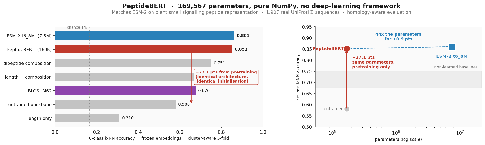

<h1 align="center">PhytoPepBERT</h1>

<p align="center">
  <strong>A 170,000-parameter protein language model for plant small signalling
  peptides, trained from scratch in NumPy, that matches ESM-2 on family
  representation.</strong>
</p>

<p align="center">
  
  
  
  
  
</p>

<p align="center">
  
  
  
  
  
</p>

<p align="center">
  <picture>
    <source media="(prefers-color-scheme: dark)" srcset="figures/hero_dark.png">
    
  </picture>
</p>

<p align="center">
  <em>Companion pretraining module for
  <a href="https://www.biorxiv.org/content/10.1101/2024.08.02.606319">S²-PepAnalyst</a>
  (IHSM La Mayora).</em>
</p>

---

## The result

Tools that identify plant small signalling peptides (SSPs) represent sequences with
a general-purpose protein language model — in current practice ESM-2 — and learn only
the classifier on plant data. This repository tests whether a representation learned
on the SSP sequence space *itself* does better.

It does not. It does about as well, at 1/44 the parameters.

Six-class family classification from frozen embeddings, 1,907 real UniProtKB
sequences, 5-fold k-NN grouped by 70%-identity cluster, chance = 16.7%:

| representation | parameters | full corpus | length-matched (n=228) |
|---|---|---|---|
| **ESM-2** `t6_8M`, zero-shot | 7,512,474 | **0.861 ± 0.028** | **0.825 ± 0.072** |
| **PhytoPepBERT** (this repo) | **169,567** | 0.852 ± 0.024 | 0.805 ± 0.054 |
| dipeptide composition | 0 | 0.751 ± 0.041 | 0.712 ± 0.095 |
| length + composition | 0 | 0.750 ± 0.049 | 0.708 ± 0.078 |
| BLOSUM62 | 0 | 0.676 ± 0.041 | 0.698 ± 0.065 |
| **untrained backbone** (identical architecture) | 169,567 | 0.580 ± 0.043 | 0.673 ± 0.064 |
| length only | 0 | 0.310 ± 0.030 | 0.330 ± 0.069 |
| exact-substring classifier | 0 | 0.357 | — |

Three things to read out of that table:

- **Pretraining is worth 27.1 points** over an architecturally identical, identically
  initialised network that was never trained. Same parameters, same seed, same
  evaluation — the difference is attributable to pretraining and nothing else.
- **It is not reachable by cheaper means.** Composition statistics and substitution
  matrices land 10–18 points below.
- **It does not beat ESM-2.** Scored on identical folds, PhytoPepBERT leads in 2 of 5
  and trails in 3, mean difference −0.9 points. We report this as a tie.

Two asymmetries work in PhytoPepBERT's favour and are measured rather than assumed:
it was pretrained on 77% of the sequences the evaluation scores, worth ~5 accuracy
points (BLOSUM62 control: −1.5 points on the same subsets), and the ESM-2 comparator
is the *smallest* checkpoint in its family.

**Where the margin is large:** with the backbone frozen, pretraining is worth
**15.3 points** on downstream classification (82.9% vs 67.6%). With the whole network
trainable it is worth 1.8 (85.4% vs 83.6%). A pipeline that embeds once and reuses the
representation sits in the frozen regime.

---

## What makes the evaluation trustworthy

Four guards, each of which *lowers* the headline numbers. They are the reason the
numbers mean something.

**1. Real sequences only.** Every sequence is a retrieved UniProtKB entry, with its
accession recorded in `results/splits.json`. Nothing is generated.

**2. Homology-aware cross-validation.** Sequences are clustered at 70% global
alignment identity (Needleman–Wunsch via `parasail`) and whole clusters are assigned
to folds. Verified by outcome, not by assumption: no validation sequence retains a
>70%-identity relative in training. Ignoring clusters inflates accuracy by **3.8 to
8.6 points** depending on representation.

**3. A real negative class.** `NONSSP` is length-matched plant proteins drawn from the
same organisms *and* the same Swiss-Prot/TrEMBL review status as the positives, so
neither taxonomy nor curation status correlates with the label. Not random strings.

**4. A reported leakage control.** `src/substring_baseline.py` searches for any
substring present in ≥90% of a class and 0% of every other. If several exist, the
labels are recoverable by `grep` and no accuracy on that corpus means anything.

```
$ python3 src/substring_baseline.py
corpus: 1907 sequences, 6 classes, chance = 0.167

  CLE        none
  NONSSP     none
  PEP        none
  PSK        'DYIYTQ'  (6 aa, 90% of family, 0% elsewhere)
  RALF       none
  RGF        none

  families with an exact discriminator: 1/5
  zero-parameter substring classifier accuracy: 0.357

  PASS with note -- PSK carries an invariant motif.
```

`DYIYTQ` is the sulfated pentapeptide that *defines* PSK — real biology, and a useful
positive control: a representation that cannot separate PSK is failing at something
easy. The control exits non-zero on failure, so it can gate CI.

> **Why this control exists.** An earlier version of this project used a corpus built
> by *in silico* mutagenesis from four seed sequences, with each family's conserved
> motif held invariant. A five-line substring classifier scored **100%** on it —
> above every learned method benchmarked, including a protein language model. No
> accuracy measured on that corpus could support any claim about representation
> quality. None of its results appear here. The failure mode is easy to reproduce and
> hard to notice, which is why the control now ships and runs.

---

## Quickstart

```bash
git clone https://github.com/MorillaLab/PhytoPepBERT && cd PhytoPepBERT
pip install -r requirements.txt
python3 run_all.py                       # ~1 h on a laptop CPU
```

`run_all.py` skips pretraining if `results/pretrained_model.npz` exists, so it is safe
to re-run. The released corpus and weights let you reproduce every figure without
retraining.

### Build the corpus from scratch

```bash
pip install requests biopython parasail
python3 build_real_corpus.py --contact you@example.org \
    --include-unreviewed --max-per-organism 3 \
    --families RALF,PSK,CLE,PEP,RGF --max-len 178 \
    --out results/splits.json
```

Fetches from UniProtKB, deduplicates, clusters, splits by cluster, and **refuses to
write a corpus that fails QC** (duplicates, homology leakage across the split, a
length shortcut, exact-substring discriminators, undersized classes, or a
positive/negative imbalance in organism or review status).

### The two head-to-head arms

```bash
python3 src/head_to_head_blosum.py                  # non-learned control
python3 src/head_to_head_esm2.py                    # needs torch + fair-esm
```

The ESM-2 script runs embedding and analysis as **separate processes**. PyTorch links
LLVM's OpenMP while NumPy/scikit-learn link Intel's via MKL; both in one process
segfaults on macOS. Once embeddings are cached, torch is never loaded again. To sweep
checkpoint sizes, add to `CHECKPOINTS` at the top of the file.

---

## Repository layout

```
build_real_corpus.py         UniProt retrieval + clustering + QC gates
run_all.py                   end-to-end driver
src/
  tensor.py                  reverse-mode autograd, pure NumPy
  model.py                   3-layer pre-norm transformer, 169,567 params
  test_tensor.py             finite-difference gradient checks (max err < 3e-4)
  corpus.py                  single source of truth for the corpus
  pretrain.py                masked-language pretraining, resumable
  eval_ppl.py                exact pseudo-perplexity   [pretrained|random_init]
  finetune.py                downstream classification [backbone] [regime]
  embeddings_analysis.py     frozen-embedding k-NN + t-SNE
  explain.py                 saliency + attention-to-motif
  head_to_head_blosum.py     non-learned control
  head_to_head_esm2.py       ESM-2 comparison, two-phase
  substring_baseline.py      leakage control
  make_figures_real.py       all four figures, from results/*.json
  make_readme_hero.py        README banner (light + dark variants)
results/                     corpus, weights, every JSON behind every figure
figures/                     generated
MANUSCRIPT.tex / .pdf        the paper
```

---

## Reproducibility notes

**Pin scikit-learn.** `StratifiedGroupKFold`'s fold-balancing changed between releases,
so fold composition and per-fold accuracies are version-dependent. The numbers above
were produced with the version pinned in `requirements.txt`. Means move by ~1–2 points
across versions; conclusions do not.

**Pretraining is not bit-reproducible across interruption patterns.** It checkpoints
every 8 epochs and re-seeds its masking RNG at each call, so exact weights depend on
where the run was interrupted. Trained weights are released so no downstream result
depends on reproducing them.

**Dependencies are split by arm.** The model, pretraining, fine-tuning, embedding
analysis and explainability need only NumPy/SciPy/scikit-learn/Matplotlib — no
deep-learning framework. Corpus construction adds `requests`, `biopython`, `parasail`.
The ESM-2 arm adds `torch` and `fair-esm` plus model-hub access.

---

## Known limitations

- **2% Swiss-Prot.** The corpus is overwhelmingly TrEMBL, so annotation quality is
  uneven and the attention-to-motif analysis rests on the ~2% of entries carrying
  curated `PEPTIDE`/`PROPEP` features. Read it as suggestive.
- **Class imbalance.** PEP has 88 sequences against 400 for the largest classes.
- **Undertrained.** Validation masked-residue accuracy was still rising at epoch 70.
- **Name-based family assignment.** CLE, PEP and RGF are retrieved by curated protein
  name because Pfam does not model them as domains. GOLVEN/RGF/CLEL entries are
  excluded from CLE explicitly and promoted to their own class; other misassignments
  may remain.
- **One checkpoint.** ESM-2 `t6_8M` only. The sweep is cheap and specified.
- **The length-matched band is weak** (n=228, three classes under 15 members). Reported
  for continuity, not as support.

---

## Citation

```bibtex
@article{morilla2026phytopepbert,
  title   = {PhytoPepBERT: a 170,000-parameter domain language model matches
             ESM-2 on plant small signalling peptide representation},
  author  = {Morilla, Ian},
  year    = {2026},
  note    = {Preprint}
}
```

> **On the name.** Not to be confused with
> [PeptideBERT](https://github.com/ChakradharG/PeptideBERT) (Guntuboina et al.,
> *J. Phys. Chem. Lett.* 2023), which fine-tunes ProtBERT for hemolysis, solubility
> and non-fouling prediction. Different model, different task, no relation.

Built in the spirit of [NucleicBERT](https://doi.org/10.1038/s42256-026-01295-9)
(Upadhyay, Herold, Götz & Schug, *Nat. Mach. Intell.*, 2026) — a small domain language
model evaluated honestly against the baselines it has to beat.
